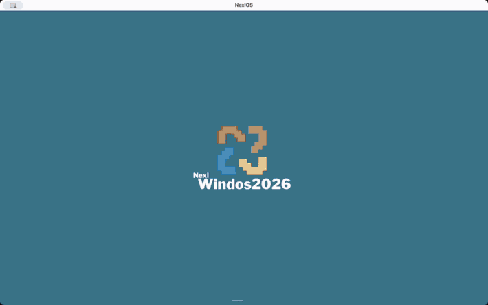

# windos2026

**English** · [简体中文](docs/i18n/README.zh-CN.md) · [繁體中文](docs/i18n/README.zh-TW.md) · [日本語](docs/i18n/README.ja.md) · [한국어](docs/i18n/README.ko.md) · [Español](docs/i18n/README.es.md) · [Français](docs/i18n/README.fr.md) · [Deutsch](docs/i18n/README.de.md)



7.94 MiB. A 2026 AI-native, ultra-light operating system: alien technology in the millennium, your private software factory today. Bring anything. Leave with an HTML app.

If a 2026 AI-native operating system had opened on your computer back in the millennium, what would you have used it for?

windos2026 is the DSH plugin edition of NexlOS. It puts a full desktop inside DSH: 17 apps, 25 commands, 8 built-in interface languages, a 7.94 MiB tarball, and one runtime dependency. Generated apps are plain files under `apps/<id>/`; the 17 built-in apps ship as code under `src/webos/`.

Everyone remembers their first desktop. This is the one you get to own: you assemble it yourself, one sentence at a time, and every app leaves with you as a file. Linux gave every program a machine; NexlOS gives every agent a computer.


## Three things stay yours

**Your model.** The plugin ships no key and sets no default provider. It reads whatever your current DSH profile already has, and when it cannot see a model it says so: the capability layer answers `501` with a reason, and the model indicator reports `unavailable` instead of pretending to be ready.

**Your apps.** Say one sentence in DSH: the generator writes `apps/<id>/index.html` plus `app.json`, opens the page in a browser to verify it, repairs it once if that check fails, then puts the icon on your desktop. Copy that directory to any static server and it still runs; hand it a GitHub URL and `importGithubApp` clones the repository, finds the built entry point, and mounts it as an app.

**Your machine.** 7.94 MiB buys 17 apps, 25 commands and 8 interface languages inside the harness you already run: no second control plane to deploy, no account, no telemetry. Install the same bundle into another DSH profile and it uses that profile's model, not ours.

## Editions and licenses

| Edition | What you get | License |
| --- | --- | --- |
| **Plugin** (source in this repository) | the 7.94 MiB package described below | [Apache-2.0](LICENSE) |
| **Universal** (Releases) | a self-contained binary with its own native window shell | the closed kernel and shell under [NexlOS Binary License 1.0](docs/LICENSE-BINARY.md); the embedded desktop layer keeps Apache-2.0 |

The authoritative file-by-file map is [LICENSING.md](docs/legal/LICENSING.md).

The universal edition is not published yet: Releases stays empty until that edition clears its asset-rights review.

## Install

Send the repository URL to DSH, then say:

```text
https://github.com/nexxxl/windos2026
install windos2026
```

DSH clones the repository and installs it into the current profile with `plugin_manager install_bundle`. You can also point it at a local directory:

```text
plugin_manager install_bundle target=/absolute/path/to/windos2026
```

Or install into the local profile without a conversation:

```sh
./scripts/install-posix.sh
powershell -ExecutionPolicy Bypass -File scripts\install-windows.ps1
```

Requires Node.js 22+ and a DSH build that can load local bundles. There is no npm release; install from this repository or the local script above.


### Octop (workbench)

The desktop does not need DSH. The same `src/webos/` and `index.js` run as a standalone host, and one command adds a persistent entry to Octop:

```bash
git clone https://github.com/nexxxl/windos2026.git
cd windos2026
./scripts/octop-install install
```

Octop's sidebar then carries **NexlOS desktop**; the desktop opens in the main workspace and the command bar answers with your own Octop agent. `./scripts/octop-install status|up|down|uninstall` manages it. Requires Node.js 22+ and an Octop install under `~/.octop`. Host differences, limits and rollback: [docs/octop.md](docs/octop.md).


## Use

- **Open the desktop**: after install, enter the Web desktop. The first launch walks through the hello screen and asks for an interface language.
- **One sentence, one app**: describe what you want in DSH; it generates an embedded app and puts it on the desktop.
- **Bring a repository**: give it a GitHub URL; it clones the repo, finds the entry point, and installs it as a desktop app.
- **Leave with it**: a generated app is just files. Copy `apps/<id>/` and it still runs on another machine.

## What is inside

| Item | Number |
| --- | --- |
| Tarball | 7.94 MiB (measured with `npm pack --dry-run --json`) |
| Unpacked | 12.6 MiB / 286 files |
| Apps | 17 |
| Commands | 25 |
| Interface languages | 8 built in, 7 optional packs |
| Themes | 2 (NEXL modern / Windos2026) |
| Runtime dependencies | 1 (`jpeg-js`) |
| License | Apache-2.0 (trademarks and third-party assets excepted) |

## Where it fits in 2026

If you arrived from a search for an **AI-native operating system**, an **agent computer**, a **software factory** or a **local-first BYOK runtime**, this is the honest match: a 7.94 MiB shell with 17 apps and 25 commands that runs inside DSH or Octop, turns one sentence into a portable HTML app, and gives an agent a workspace it can keep.

- **Agent-native**: the desktop is the surface; generated apps are the artifacts.
- **Software factory**: one sentence, one app, checked in a real browser, repaired once.
- **Verified, not just generated**: a temporary Chromium checks console errors and declared interactions; only a passing app gets a desktop icon.
- **Browser-surface reconstruction**: behavior capture, spec, rebuild and comparison stop at the browser; binaries stay out of scope.
- **Tiny and portable**: 7.94 MiB, 286 files, one runtime dependency.
- **Local-first**: no account, no telemetry, no default model provider.
- **GPU-drawn UI**: a WebGL graph view and a WebGL2 shader companion, both with Canvas2D fallbacks.
- **3D author layer (universal edition)**: Three.js, glTF/GLB with KTX2, Draco and meshopt, on our own WebGL2/WebGPU surface. In progress, not in this tarball.

Each search phrase mapped to what actually exists, plus what this project deliberately does **not** claim: [docs/highlights.md](docs/highlights.md). How the production line records evidence: [docs/factory.md](docs/factory.md). Value page and common searches: [docs/faq.md](docs/faq.md). Use and redistribution boundaries: [docs/research-use.md](docs/research-use.md). Machine-readable summary for AI crawlers: [llms.txt](llms.txt).

## What it refuses to do

- No third-party account and no hosted app store; apps, code and data stay on your machine.
- No telemetry.
- No system changes; the installer only writes DSH profile dependencies and links, and uninstalling removes exactly those.
- No CJK office font pack, universal-edition binaries or internal project history in the published tarball or the public source candidate. The tarball's only CJK face is the OFL pixel font declared in THIRD_PARTY_NOTICES.
- No claim that Windows is fully validated; treat the Windows path as alpha and report what breaks.

## Develop

```sh
npm ci
npm run check
npm test
npm pack --pack-destination /absolute/path/to/artifacts
```

Size gate:

```sh
./scripts/verify-lite.sh
```

## License

The plugin source in this repository is Apache-2.0. Release binaries of the universal edition follow a separate license; see [LICENSING.md](docs/legal/LICENSING.md) for the map and [LICENSE-BINARY.md](docs/LICENSE-BINARY.md) for its terms.

Plugin source and documentation are [Apache-2.0](LICENSE). Trademarks are not granted by Apache-2.0; third-party assets keep their own licenses. Provenance, license texts and porting notes are in [THIRD_PARTY_NOTICES.md](docs/legal/THIRD_PARTY_NOTICES.md); trademark rules in [TRADEMARK.md](docs/legal/TRADEMARK.md); warranty and liability terms in [DISCLAIMER.md](docs/legal/DISCLAIMER.md).

ArtCraft for NexlOS (ArtCraft 移植版) is the worked example shipped with the built-in app generator, and the one place where algorithms come from an upstream project. It installs upstream ArtCraft's editor structure and portable algorithms into NexlOS, then rebuilds them against this project's own contract: commands, a single serializable document state, and a mount/destroy panel. The porting approach and the file-by-file mapping are in [docs/artcraftport/ATTRIBUTION.md](docs/artcraftport/ATTRIBUTION.md): the upstream is storytold's ArtCraft (`github.com/storytold/artcraft`, MIT / Apache-2.0), rewritten here as zero-dependency ES modules under the MIT terms. The Rust renderer, Tauri host and AI calls are not included. This port is **unofficial** and has no affiliation with or endorsement from the upstream team; the name ArtCraft in the app title names the upstream project and is always qualified with "for NexlOS". The app id, route and directory are `artcraftport`.
