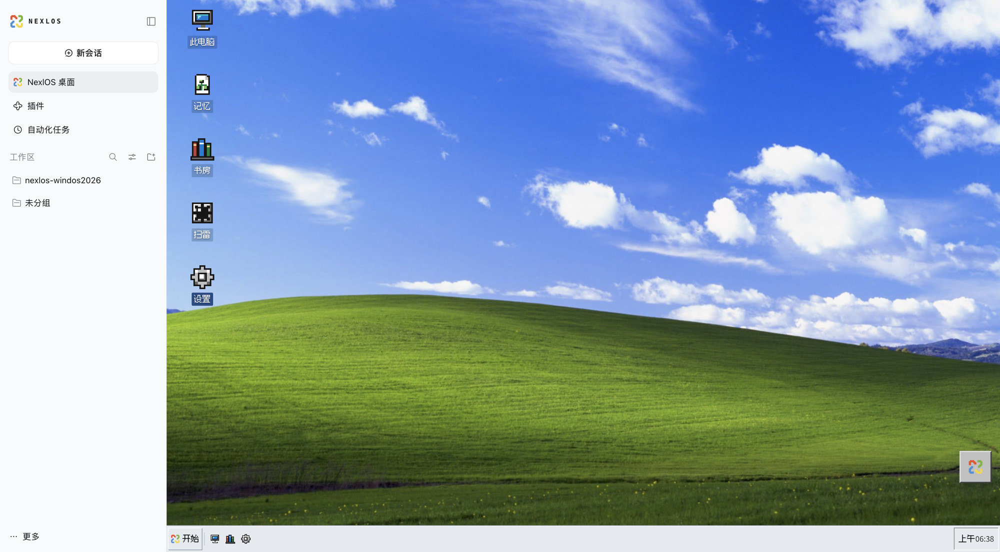

# windos2026

[English](README.md) · [简体中文](README.zh-CN.md) · **繁體中文** · [日本語](README.ja.md) · [한국어](README.ko.md) · [Español](README.es.md) · [Français](README.fr.md) · [Deutsch](README.de.md)

7.95 MiB，一台 2026 年的 AI 超輕原生作業系統：回到千禧年是外星科技，留在今天是你的私人軟體工廠。Bring anything. Leave with an HTML app.

如果回到千禧年，你的電腦意外打開一個2026年的AI原生作業系統，你會用來幹嘛？

windos2026 是 NexlOS 的 DSH 外掛版。它把一台完整的桌面裝進 DSH：17 個應用程式、25 條指令、8 種內建介面語言，壓縮包 7.95 MiB，只有一個執行階段相依套件。生成的應用程式就是 `apps/<id>/index.html` 加一份 `app.json`；17 個內建應用程式以程式碼形式放在 `webos/`。

你還記得你用過的第一台電腦桌面長什麼樣子嗎？這一台可以完全是你自己的：一句話生出一個應用程式，每個應用程式都以檔案的形式跟著你走。Linux 給了每個程式一台機器；NexlOS 給了每個 agent 一台電腦。

## 三樣東西始終是你的

**你的模型。** 外掛不帶 key，也不設預設 provider。它讀的是你目前 DSH 設定檔裡既有的東西；看不到模型時它直說：能力層回傳 `501` 並附原因，模型狀態顯示 `unavailable`，不假裝就緒。

**你的應用程式。** 在 DSH 裡說一句話：生成器寫出 `apps/<id>/index.html` 和 `app.json`，用瀏覽器打開頁面做驗收，驗收不過就自動修一次，然後把圖示放上桌面。把這個目錄複製到任何靜態伺服器上，它照樣能跑；給它一個 GitHub 位址，`importGithubApp` 會複製倉庫、找到建置後的入口，掛成應用程式。

**你的機器。** 7.95 MiB 換來 17 個應用程式、25 條指令、8 種介面語言，裝在你正在跑的宿主裡：不用再部署一套控制面，沒有帳號，沒有遙測。把同一個 bundle 裝進另一個 DSH 設定檔，它用的是那個設定檔的模型，不是我們的。

## 兩種發行，兩套授權

| 形態 | 你拿到的東西 | 授權 |
| --- | --- | --- |
| **外掛版**（本倉原始碼） | 下文所述的 7.95 MiB 外掛包 | [Apache-2.0](LICENSE) |
| **通用版**（Releases） | 自帶原生視窗殼的獨立二進位 | 閉源內核與視窗殼按 [NexlOS Binary License 1.0](docs/LICENSE-BINARY.md)；內建桌面層保持 Apache-2.0 |

逐檔案、逐產物的權威對映見 [LICENSING.md](LICENSING.md)。

通用版還沒發布：在它的資產授權複核完成之前，Releases 不會掛出二進位檔。

## 安裝

把倉庫網址傳給 DSH，再說一句：

```text
https://github.com/nexxxl/windos2026
安裝 windos2026
```

DSH 會複製倉庫，再用 `plugin_manager install_bundle` 裝進目前設定檔。也可以直接指向本機目錄：

```text
plugin_manager install_bundle target=/absolute/path/to/windos2026
```

或者不經過對話，用指令碼裝進本機 profile：

```sh
./scripts/install-posix.sh
powershell -ExecutionPolicy Bypass -File scripts\install-windows.ps1
```

需要 Node.js 22+ 和可載入本機 bundle 的 DSH。沒有 npm 發佈，請用上面的倉庫安裝或本機腳本。



### Octop（工作台）

桌面不依賴 DSH。同一份 `webos/` 和 `index.js` 也能作為獨立宿主執行，一條指令把它掛進 Octop：

```bash
git clone https://github.com/nexxxl/windos2026.git
cd windos2026
./bin/octop-install install
```

Octop 左側會多出常駐的 **NexlOS 桌面**，點開佔滿右側主工作區；命令列回答用的是你自己的 Octop agent。`./bin/octop-install status|up|down|uninstall` 負責管理。需要 Node.js 22+ 和裝在 `~/.octop` 的 Octop。宿主差異、邊界與回滾見 [docs/octop.md](docs/octop.md)。


## 使用

- **打開桌面**：裝好後進入 Web 桌面；首次會先過一次 hello 引導，選好介面語言再進系統。
- **說一句話造應用**：在 DSH 裡描述你要的東西，它會生成一個內嵌應用程式，落到桌面上。
- **把倉庫搬進來**：給一個 GitHub 網址，它會複製、找入口，裝成桌面應用程式。
- **帶走**：生成的應用程式就是檔案。複製 `apps/<id>/`，換一台機器照樣能跑。

## 裡面有什麼

| 項目 | 數字 |
| --- | --- |
| 壓縮包 | 7.95 MiB |
| 解包 | 12.6 MiB / 293 檔案 |
| 應用程式 | 17 |
| 指令 | 25 |
| 介面語言 | 8 種內建，7 種可選語言包 |
| 主題 | 2 套（NEXL 現代 / Windos2026） |
| 執行階段相依 | 1（`jpeg-js`） |
| 授權 | Apache-2.0（商標與第三方素材除外） |

## 它不做什麼

- 不需要第三方帳號，不需要託管的應用程式商店；應用程式、程式碼和資料都在你自己的機器上。
- 不收集遙測。
- 不改系統設定；安裝指令碼只寫 DSH profile 的相依與連結，解除安裝只移除這些。
- 發布的壓縮包與公開原始碼候選不含 CJK 辦公字型包、通用版二進位檔和內部專案歷史；包內唯一的中文字面是 THIRD_PARTY_NOTICES 裡聲明的 OFL 像素字型。
- 不聲稱 Windows 已完整驗證；Windows 路徑按 alpha 對待，發現問題請提 issue。

## 開發

```sh
npm ci
npm run check
npm test
npm pack --pack-destination /absolute/path/to/artifacts
```

體積檢查：

```sh
./scripts/verify-lite.sh
```

## 授權

本倉庫的外掛原始碼按 Apache-2.0 提供；通用版的 Release 二進位另按一套授權，對映見 [LICENSING.md](LICENSING.md)，條款見 [LICENSE-BINARY.md](docs/LICENSE-BINARY.md)。

外掛原始碼與文件依 [Apache-2.0](LICENSE) 提供。商標不隨 Apache-2.0 授予，第三方素材依各自授權，見 [NOTICE](NOTICE)、[TRADEMARK.md](TRADEMARK.md)、[THIRD_PARTY_NOTICES.md](THIRD_PARTY_NOTICES.md)。
