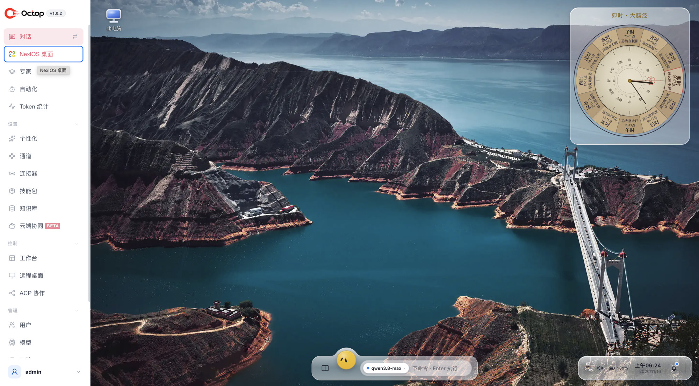

# windos2026

[English](../../README.md) · [简体中文](README.zh-CN.md) · [繁體中文](README.zh-TW.md) · [日本語](README.ja.md) · **한국어** · [Español](README.es.md) · [Français](README.fr.md) · [Deutsch](README.de.md)

7.94 MiB. 2026년의 AI 네이티브 초경량 운영체제. 밀레니엄으로 가면 외계 기술, 오늘은 당신의 개인 소프트웨어 공장. Bring anything. Leave with an HTML app.

밀레니엄으로 돌아갔을 때 컴퓨터가 갑자기 2026년의 AI 네이티브 OS를 열었다면, 무엇에 쓰시겠습니까?

windos2026은 NexlOS의 DSH 플러그인 에디션입니다. DSH 안에 완전한 데스크톱을 넣습니다. 앱 17개, 명령 25개, 내장 UI 언어 8개, tarball 7.94 MiB, 런타임 의존성 1개. 생성한 앱은 `apps/<id>/index.html`과 `app.json`뿐인 파일입니다. 내장 17개 앱은 `webos/`의 코드로 함께 배포합니다.

*번역본입니다. 기준 문서는 영어판입니다.*

당신이 처음 쓴 컴퓨터의 데스크톱이 어떤 모습이었는지 기억하나요? 이번 것은 당신이 직접 조립하는 한 대입니다. 한 문장이면 앱이 생기고, 모든 앱은 파일로 당신을 따라옵니다. Linux는 모든 프로그램에게 한 대의 기계를 주었습니다. NexlOS는 모든 agent에게 한 대의 컴퓨터를 줍니다.

## 끝까지 당신의 것인 세 가지

**당신의 모델.** 플러그인은 key를 넣지 않고 기본 provider도 설정하지 않습니다. 현재 DSH 프로필에 이미 있는 것을 그대로 읽고, 모델이 보이지 않으면 그렇게 말합니다. 능력 계층은 이유와 함께 `501`을 돌려주고, 모델 상태는 `unavailable`로 표시하며, 준비된 척하지 않습니다.

**당신의 앱.** DSH에서 한 문장을 말하면 생성기가 `apps/<id>/index.html`과 `app.json`을 쓰고, 브라우저로 페이지를 열어 검증하고, 실패하면 한 번 자동으로 고친 뒤 아이콘을 데스크톱에 올립니다. 그 디렉터리를 아무 정적 서버에 복사해도 그대로 실행됩니다. GitHub URL을 주면 `importGithubApp`이 저장소를 복제하고 빌드된 진입점을 찾아 앱으로 마운트합니다.

**당신의 기계.** 7.94 MiB로 앱 17개, 명령 25개, UI 언어 8개를 이미 돌리고 있는 하네스 안에 넣습니다. 배포할 두 번째 제어면도, 계정도, 텔레메트리도 없습니다. 같은 bundle을 다른 DSH 프로필에 설치해도 그것은 그 프로필의 모델을 쓰지, 우리 것을 쓰지 않습니다.

## 두 가지 에디션, 두 가지 라이선스

| 에디션 | 받는 것 | 라이선스 |
| --- | --- | --- |
| **플러그인판**(이 저장소의 소스) | 아래에 설명된 7.94 MiB 패키지 | [Apache-2.0](../../LICENSE) |
| **유니버설판**(Releases) | 자체 네이티브 창 셸을 포함한 단일 바이너리 | 비공개 커널과 셸은 [NexlOS Binary License 1.0](../LICENSE-BINARY.md), 내장 데스크톱 계층은 Apache-2.0 유지 |

파일 단위의 권위 있는 대응표는 [LICENSING.md](../legal/LICENSING.md)에 있습니다.

유니버설판은 아직 공개되지 않았습니다. 자산 권리 검토가 끝날 때까지 Releases에 바이너리를 올리지 않습니다.

## 설치

저장소 URL을 DSH에 보내고 이렇게 말합니다.

```text
https://github.com/nexxxl/windos2026
install windos2026
```

DSH가 저장소를 clone하고 `plugin_manager install_bundle`로 현재 프로필에 설치합니다. 로컬 디렉터리를 직접 지정할 수도 있습니다.

```text
plugin_manager install_bundle target=/absolute/path/to/windos2026
```

대화 없이 로컬 프로필에 설치할 수도 있습니다.

```sh
./scripts/install-posix.sh
powershell -ExecutionPolicy Bypass -File scripts\install-windows.ps1
```

Node.js 22+와 로컬 bundle을 로드할 수 있는 DSH가 필요합니다. npm 배포는 없습니다. 위 저장소 또는 로컬 스크립트에서 설치하세요.


### Octop(워크벤치)

데스크톱은 DSH가 필요하지 않습니다. 같은 `webos/`와 `index.js`가 독립 호스트로 실행되며, 명령 하나로 Octop에 상주 항목을 추가합니다.

```bash
git clone https://github.com/nexxxl/windos2026.git
cd windos2026
./bin/octop-install install
```

Octop 사이드바에 **NexlOS 데스크톱**이 상주하고, 메인 작업 공간에 열립니다. 명령 바는 당신의 Octop agent가 답합니다. `./bin/octop-install status|up|down|uninstall`로 관리합니다. Node.js 22+와 `~/.octop`에 설치된 Octop이 필요합니다. 호스트별 차이, 제한, 롤백은 [docs/octop.md](../octop.md)를 참고하세요.



## 사용

- **데스크톱 열기**: 설치 후 웹 데스크톱으로 들어갑니다. 첫 실행에서는 hello 화면에서 UI 언어를 고릅니다.
- **한 문장으로 앱 만들기**: DSH에서 원하는 것을 설명하면 내장 앱을 생성해 데스크톱에 올립니다.
- **저장소 가져오기**: GitHub URL을 주면 clone하고 진입점을 찾아 데스크톱 앱으로 설치합니다.
- **가지고 나가기**: 생성한 앱은 파일입니다. `apps/<id>/`를 복사하면 다른 기기에서도 실행됩니다.

## 포함된 것

| 항목 | 숫자 |
| --- | --- |
| tarball | 7.94 MiB |
| 압축 해제 | 12.6 MiB / 286 파일 |
| 앱 | 17 |
| 명령 | 25 |
| UI 언어 | 내장 8개, 선택 팩 7개 |
| 테마 | 2 (NEXL 모던 / Windos2026) |
| 런타임 의존성 | 1 (`jpeg-js`) |
| 라이선스 | Apache-2.0 (상표와 제3자 자산 제외) |

2026년 위치와 검색어 대응, 그리고 이 프로젝트가 명확히 주장하지 않는 것: [docs/highlights.md](../highlights.md). 가치 페이지와 자주 검색되는 질문: [docs/faq.md](../faq.md). 사용과 재배포 경계: [docs/research-use.md](../research-use.md). AI 크롤러용 요약: [llms.txt](../../llms.txt).

## 하지 않는 것

- 제3자 계정도, 호스팅 앱 스토어도 필요 없습니다. 앱, 코드, 데이터는 당신의 기기에 남습니다.
- 텔레메트리를 수집하지 않습니다.
- 시스템 설정을 바꾸지 않습니다. 설치 프로그램은 DSH 프로필의 의존성과 링크만 쓰고, 제거는 그것만 지웁니다.
- 공개 tarball과 공개 소스 후보에는 CJK 오피스 폰트 팩, 유니버설 에디션 바이너리, 내부 개발 이력이 들어가지 않습니다. tarball 안의 유일한 CJK 서체는 THIRD_PARTY_NOTICES에 적힌 OFL 픽셀 폰트입니다.
- Windows가 완전히 검증되었다고 주장하지 않습니다. Windows 경로는 alpha로 취급합니다.

## 개발

```sh
npm ci
npm run check
npm test
npm pack --pack-destination /absolute/path/to/artifacts
```

크기 게이트:

```sh
./scripts/verify-lite.sh
```

## 라이선스

이 저장소의 플러그인 소스는 Apache-2.0입니다. 유니버설판 Release 바이너리는 별도 라이선스를 따르며, 대응표는 [LICENSING.md](../legal/LICENSING.md), 조건은 [LICENSE-BINARY.md](../LICENSE-BINARY.md)에 있습니다.

플러그인 소스와 문서는 [Apache-2.0](../../LICENSE)입니다. 상표는 Apache-2.0으로 부여되지 않으며, 제3자 자산은 각자의 라이선스를 따릅니다. [NOTICE](../legal/NOTICE), [TRADEMARK.md](../legal/TRADEMARK.md), [THIRD_PARTY_NOTICES.md](../legal/THIRD_PARTY_NOTICES.md)를 참고하세요.
